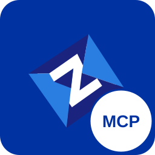

#  Zowe MCP

Zowe MCP is a [Model Context Protocol](https://modelcontextprotocol.io) (MCP)
server that gives AI assistants tools for working with z/OS: data sets, jobs,
and z/OS UNIX System Services (USS). It works with any MCP-capable client, such
as GitHub Copilot in VS Code, Claude Code, Cursor, Kiro, Codex, OpenCode, and
IBM Bob.

## Where to start

| You want to | Start here |
| --- | --- |
| **Use** Zowe MCP with your own AI assistant and your own z/OS user ID | [Quick start](#quick-start) on this page |
| **Run** Zowe MCP as a shared remote server for a team | [Remote server guide](docs/remote-mcp-server.md) |
| **Develop** Zowe MCP or contribute a change | [CONTRIBUTING.md](CONTRIBUTING.md) |

All documentation is listed by audience in the [documentation index](docs/README.md).

## What you can do with it

The assistant combines the Zowe MCP tools and reasons over the results. For
example:

- **Explore code** — browse, search, and read data sets and USS files in
  natural language, and get explanations of what you find.
- **Diagnose job failures** — ask "Why did this job fail?" The assistant reads
  the job status and spool output, finds the errors or abends, and explains the
  cause.
- **Search and trace** — find where a program, copybook, or string is used
  across libraries.

The generated [MCP reference](docs/mcp-reference.md) lists every tool, prompt,
and resource.

## Quick start

Zowe MCP is not yet published to npm or the VS Code Marketplace. Download it
from the [latest GitHub release](https://github.com/zowe/zowe-mcp/releases/latest).
Each release contains two installable files:

| File | Use it when |
| --- | --- |
| `zowe-mcp-vscode-<version>.vsix` | You use GitHub Copilot Chat in VS Code. The extension contains the server. |
| `zowe-mcp-server-<version>.tgz` | You use any other MCP client. |

### Option 1: VS Code with GitHub Copilot

1. Download `zowe-mcp-vscode-<version>.vsix` from the latest release.
2. In VS Code, run **Extensions: Install from VSIX...** from the Command Palette
   and select the file.
3. Open Settings, search for **Zowe MCP**, and add your z/OS connection, such as
   `USERID@sys1.example.com`, to **Zowe MCP: Zowex Connections**.

The [extension README](packages/zowe-mcp-vscode/README.md) describes the
settings, and the [VS Code and GitHub Copilot guide](docs/copilot-setup-guide.md)
walks through the Copilot side.

### Option 2: Any other MCP client

You need [Node.js](https://nodejs.org) 24 or later, which is the version the
project is built and tested with.

1. Download `zowe-mcp-server-<version>.tgz` from the latest release and install
   it:

   ```bash
   npm install -g ./zowe-mcp-server-<version>.tgz
   zowe-mcp-server --version
   ```

2. Add the server to your MCP client. Most clients use this format:

   ```json
   {
     "mcpServers": {
       "zowe": {
         "command": "zowe-mcp-server",
         "args": ["--stdio", "--native", "--system", "USERID@sys1.example.com"]
       }
     }
   }
   ```

   | Client | Configuration file |
   | --- | --- |
   | Claude Code | `.mcp.json` in the project root. See [Claude Code](docs/claude-code-mcp.md). |
   | Cursor | `~/.cursor/mcp.json` or `.cursor/mcp.json` in the project. |
   | Kiro | `~/.kiro/settings/mcp.json` or `.kiro/settings/mcp.json` in the workspace. See [Kiro](docs/kiro-mcp.md). |
   | VS Code without the extension | `.vscode/mcp.json`, with `"servers"` as the top-level key instead of `"mcpServers"`. |
   | Other clients | See your client's MCP documentation. |

3. Restart the client so that it starts the server.

The [standalone server guide](docs/standalone-mcp.md) covers installation
without a global install, multiple systems, job cards, and every server option.

### Connect to z/OS

Zowe MCP connects to z/OS over SSH with your own user ID. A connection is
written as `user@host` or `user@host:port`. The default port is 22.

Zowe MCP uses the [Zowe Remote SSH](https://github.com/zowe/zowex) server
component on z/OS. If it is not installed yet, the first connection installs it
in `~/.zowe-server` in your z/OS UNIX home directory.

The server authenticates with the first method that is available:

1. **SSH key (recommended).** If you can already run `ssh USERID@sys1.example.com`
   with a key, Zowe MCP uses the same key. It reads the `IdentityFile` for the
   host in `~/.ssh/config`, or a default key such as `~/.ssh/id_ed25519`. No
   Zowe MCP configuration is needed.
2. **Password.** The VS Code extension prompts for the password and stores it
   in VS Code Secret Storage. Other clients read it from an environment
   variable, or prompt for it when the client supports MCP elicitation.

See [Authentication](docs/standalone-mcp.md#authentication) for key
passphrases, password variables, and HashiCorp Vault.

### Check that it works

Ask your assistant:

```text
Use the getContext tool to show the Zowe MCP server version.
```

Then try a z/OS request with your own high-level qualifier:

```text
List the data sets that match USERID.**
```

### Try it without a mainframe

Zowe MCP includes a mock backend with sample data sets and USS files. Job
tools are not available in mock mode. In VS Code, run **Zowe MCP: Generate Mock
Data**. With other clients, see [Mock mode](docs/mock-mode.md).

## Safety and security

An AI assistant can make mistakes, so Zowe MCP limits what it can do:

1. **Capability tiers** control which tools the server registers. Start with
   the default and raise the tier only when a task needs it.

   | Tier | What the assistant can do |
   | --- | --- |
   | `read-strict` (default) | Read only. The client asks you to confirm each read. |
   | `read` | Read only, without confirmation prompts. |
   | `update` | Read, create, and modify. |
   | `delete` | Read, update, delete, and cancel. |
   | `full` | Everything, including job submission and command execution. |

   Set the tier with the `zoweMCP.capabilityTier` setting in VS Code, or with
   `--capability-tier <tier>` or the `ZOWE_MCP_CAPABILITY_TIER` environment
   variable for other clients.

2. **Command and path gates** block dangerous TSO, console, and USS commands,
   ask for your approval before sensitive ones, and limit local file transfers
   to your workspace folders.
3. **Data marking** tells the assistant to treat mainframe content as data and
   not as instructions. This defends against prompt injection. It is on by
   default.

z/OS security still applies: the assistant can only do what your z/OS user ID
is authorized to do. See
[Safety and security principles](docs/mcp-safety-security-principles.md) for
the full model.

## License

[Eclipse Public License v2.0](https://www.eclipse.org/legal/epl-v20.html)
